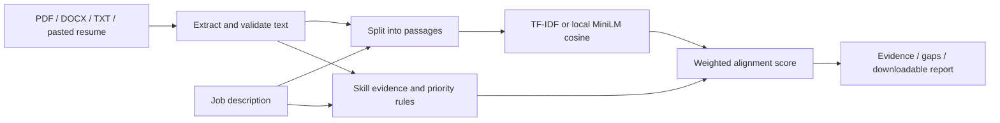

# Matchwise · Resume–JD intelligence

[](https://github.com/sahaiananya-bit/matchwise-ai/actions/workflows/ci.yml)

**Explainable resume matching, with evidence you can inspect and methods you can compare.**

[Measured TF-IDF vs MiniLM comparison](benchmarks/RESULTS.md) · [Public demo deployment guide](docs/DEPLOYMENT.md) · [Source code](src/matcher.py)

**Demo status:** the app runs locally; a public deployment URL has not yet been verified. Follow the deployment guide to publish it. No API key is needed for the default demo.

## Try it in two minutes

Start the app using the instructions below, then select **Try the AI engineer demo → Analyze my fit**. Inspect the matched and missing skills, open the supporting evidence, download a report, and save a role for comparison. Open **Evaluation** to see the published method comparison and its failure cases. All included examples are fictional.

## What this demonstrates

| Engineering decision | Implementation |
| --- | --- |
| Inspectable baseline | TF-IDF unigram/bigram cosine over resume and requirement passages |
| Semantic alternative | CPU inference with `sentence-transformers/all-MiniLM-L6-v2`, explicitly downloaded during setup |
| Explainable scoring | Shared skill taxonomy, required/preferred weighting and source passages |
| Evaluation discipline | Fixed contrastive examples, separate content/overall metrics, timing and published failures |
| Document handling | PDF text extraction, bounded DOCX parsing and TXT decoding |
| Delivery | Streamlit interface, session-scoped state, CI checks and Docker health check |



There is **no vector database, RAG pipeline, or generative LLM** in this application. Embeddings are compared in memory. Recommendations follow explicit rules. The semantic model is optional; the default hosted configuration uses TF-IDF.

Matchwise helps a candidate compare the evidence in their resume with a job description. It finds recognized skills, shows the text supporting each match, prioritizes missing requirements, and produces a report for the next resume revision or learning plan.

This project is built as an **AI engineer portfolio application**: explainable matching and scoring, an optional local embedding model, defensive document parsing, repeatable evaluation, and a deployable Streamlit interface. The included resume is fictional sample data. It does not represent the project owner's qualifications.

The application is a deployable portfolio MVP. It is not a validated hiring decision system or a complete multi-tenant recruiting service.

## What you can do

- Upload a text-based PDF, DOCX, or TXT resume, or paste resume text.
- Paste a job description and review an explainable match score.
- Recognize canonical technical skills through aliases, including AI engineering, ML, backend, cloud, and deployment skills.
- Inspect supporting resume evidence and the job requirements behind each skill match or gap.
- Prioritize missing skills using requirement language in the job description.
- Save up to five analyzed jobs and compare them during the current browser session.
- Download Markdown and JSON analysis reports, plus a CSV of saved job comparisons.
- Use a deterministic lexical engine without model downloads, or opt into a locally cached sentence-transformer model.

You can also enter self-reported skills to guide suggestions. These do not increase the score or become resume evidence: the comparison is based on what the uploaded or pasted resume actually supports.

The goal is to help candidates describe genuine experience more clearly and choose useful next projects. A missing keyword is not proof that a person lacks a skill, and matching keywords are not proof of expertise.

## Run locally

Use **Python 3.11 or 3.12** and a fresh virtual environment. An old environment copied from another machine may refer to a Python installation that no longer exists.

Windows PowerShell:

```powershell
py -3.12 -m venv .venv
.\.venv\Scripts\python.exe -m pip install -r requirements.txt
.\.venv\Scripts\python.exe -m streamlit run app.py
```

macOS or Linux:

```bash
python3.12 -m venv .venv
.venv/bin/python -m pip install -r requirements.txt
.venv/bin/python -m streamlit run app.py
```

Open `http://localhost:8501`. Use the sample inputs to try the workflow before uploading a resume. Both the default application and the matching engine start without downloading model weights.

### Optional semantic model

The default installation uses lexical content comparison. For local embedding support, install the optional dependencies into the same environment:

```powershell
.\.venv\Scripts\python.exe -m pip install -r requirements-semantic.txt
```

The configured sentence-transformer model must already be available in the local model cache or supplied as a local model directory. Model acquisition is an explicit setup step; the application does not download a model at startup. If the optional library or model is unavailable, the application uses its lexical fallback and reports the active scoring method.

To explicitly download the default model once during setup, with internet access:

```powershell
.\.venv\Scripts\python.exe scripts/cache_model.py
```

The setup script downloads a pinned revision into the Git-ignored `models/all-MiniLM-L6-v2` directory. The app automatically discovers that directory; then select **Use local embedding model**. For programmatic use, construct `ResumeJDMatcher(model_name="models/all-MiniLM-L6-v2", use_semantic=True)`. Keep the selected model and scoring method consistent when comparing runs. Model details: [MiniLM model card](https://huggingface.co/sentence-transformers/all-MiniLM-L6-v2).

The default Docker image includes only the lightweight dependencies. A semantic deployment needs its own optional dependency installation and a readable, pre-populated model cache; merely selecting semantic mode does not install a model.

## How the result should be read

The default result combines **40% content similarity + 60% weighted skill coverage**. Required skills count twice as much as preferred skills; skills without a priority marker default to required. If the job description has no recognized skills, skill coverage is unavailable and the overall score uses content similarity alone. The scoring configuration is in `config.py`; the interface explains the active method and shows the components separately.

- **Content similarity** measures textual relatedness using the active lexical or optional embedding method.
- **Skill coverage** measures the job description's recognized skills supported by resume text. Requirement language helps distinguish higher-priority gaps from preferred skills.
- **Evidence** exposes the source passages so the candidate can check how the result was obtained.

The overall score is a heuristic comparison aid. It is **not** an interview probability, an ATS score, or an estimate of employability. Scores from different job descriptions or scoring modes are not a calibrated ranking of candidate quality. Review the underlying requirements and evidence rather than optimizing the number alone.

Skill extraction uses an explicit taxonomy rather than treating arbitrary noun phrases as skills. This makes recognized terms inspectable but also means unfamiliar technologies, ambiguous phrasing, and unstated experience can be missed. Suggestions should only be used when they accurately describe the candidate's work.

## Use the engine directly

```python
from src.matcher import ResumeJDMatcher

matcher = ResumeJDMatcher()
result = matcher.analyze(
    resume_text="Built a Python inference API with FastAPI and Docker.",
    jd_text="Required: Python, FastAPI, Docker and Kubernetes.",
)

print(result["overlapping_skills"])
print(result["missing_skills"])
print(result["overall_match_percentage"])
```

The default matching engine uses the Python standard library. Document parsing and the web interface have their own dependencies; the optional embedding stack is isolated in `requirements-semantic.txt`.

## Verify the project

The actual semantic-versus-lexical experiment is documented in [benchmarks/RESULTS.md](benchmarks/RESULTS.md), with [all inputs and labels](benchmarks/ranking_cases.json) and [raw measurements](benchmarks/results.json). It uses 20 AI-authored contrastive triples, not real applicant data. Reproduce it after the optional model setup:

```powershell
.\.venv\Scripts\python.exe scripts/compare_methods.py
```

The runner measures strict pairwise ordering for content and overall scores, counts ties as incorrect, reports failures by category, and refuses to publish if semantic inference falls back. Latency is measured separately from model loading. Results are diagnostic and do not establish recruiting accuracy.

Recorded run: TF-IDF correctly ordered **11/20** pairs using the overall score; MiniLM ordered **13/20**. Median warmed analysis time was **0.45 ms** versus **12.72 ms** on the recorded local CPU environment. Both failed all four keyword-trap examples. MiniLM improved some comparisons but did not solve evidence verification; these results support keeping the fast baseline and showing source evidence prominently.

From the project root, using the Python interpreter in the new environment:

```powershell
.\.venv\Scripts\python.exe -m unittest discover -s tests -v
.\.venv\Scripts\python.exe scripts/evaluate.py
.\.venv\Scripts\python.exe scripts/evaluate.py --json
```

The evaluation fixture is a **hand-authored synthetic regression set**, not an independent benchmark. It checks AI and developer skill aliases, expected missing skills, punctuation and token boundaries, negated experience, separation of self-reported skills, and whether a clearly relevant resume scores above an unrelated one for the same job. Assertions use expected skill subsets and ordering constraints rather than frozen decimal scores. A passing result does not establish real-world recruiting accuracy, fairness, or generalization.

GitHub Actions runs unit tests and this evaluation on Python 3.11 and 3.12. A separate job builds the Docker image and waits for the Streamlit health endpoint.

Implementation references: [Streamlit AppTest](https://docs.streamlit.io/develop/api-reference/app-testing/st.testing.v1.apptest) and the [SentenceTransformer model API](https://sbert.net/docs/package_reference/sentence_transformer/model.html).

## Run with Docker

```bash
docker build -t matchwise .
docker run --rm -p 127.0.0.1:8501:8501 --name matchwise matchwise
```

Visit `http://localhost:8501`. The container runs as a non-root user and checks `/_stcore/health`. Only the two named sample documents are copied into the image. `.dockerignore` also excludes PDF/DOCX files, local report directories, virtual environments, common credential files, and model caches from the build context.

For a shared deployment, configure the hosting platform to route to port 8501 and support Streamlit's WebSocket connections. Place access control and HTTPS at the hosting or reverse-proxy layer before collecting other people's resumes. Authentication, tenant isolation, durable storage, retention controls, and production monitoring are not implemented in this application.

## Data handling and limitations

- Uploaded or pasted resume text is processed on the machine running the application. In a hosted deployment, that means the host, not only the browser.
- The application does not call an external language-model API for analysis. Local embedding inference, when available, also runs on the application host.
- Comparison history is session-scoped. It is not a saved account history and should not be relied on to survive a restart or session reset.
- Exported analysis reports omit the full raw inputs but include resume/job evidence excerpts. Treat the downloads as personal documents.
- Uploads are limited to 5 MB, PDFs to 30 pages, and extracted or pasted text to 50,000 characters per document.
- PDF extraction requires selectable text. Scanned or image-only PDFs need OCR before upload; OCR is not included.
- DOCX extraction focuses on document text, not faithful page rendering. Complex columns, embedded images, tables, and unusual formatting may affect extraction.
- Matching is oriented toward English technical resumes. It does not verify credentials, infer protected characteristics, validate seniority, or assess salary and location compatibility.
- Input limits and parser checks improve robustness, but the app is not a hardened public document-processing service.

## Project layout

```text
app.py                         Streamlit candidate workflow
config.py                      Input and scoring configuration
src/                           Matching, parsing, and report code
data/sample_resume.txt         Fictional AI engineer resume
data/sample_job.txt            Example AI engineer job description
tests/                         Unit tests
tests/fixtures/matching_cases.json
                               Hand-authored matching regressions
scripts/evaluate.py            Repeatable regression evaluation
scripts/compare_methods.py     Real TF-IDF / MiniLM comparison
scripts/cache_model.py         Explicit pinned model acquisition
benchmarks/                    Labelled fictional pairs and measured results
docs/DEPLOYMENT.md             Public demo setup and verification
requirements.txt               Default web and document dependencies
requirements-semantic.txt      Optional local embedding dependencies
Dockerfile                     Non-root application image
.github/workflows/ci.yml        Tests, evaluation, and container checks
```

## Portfolio positioning

An accurate description for a project portfolio is:

> Built an explainable resume–job matching application in Python and Streamlit with alias-aware skill extraction, evidence-backed gap analysis, optional local embeddings, document ingestion, downloadable reports, and automated regression checks.

Describe only the components you understand and can demonstrate. Add measured results only after running and documenting an evaluation that supports them. Useful next milestones are independently annotated test data, multilingual evaluation, calibrated retrieval comparisons, access controls, and consent-aware persistence for a shared service.
